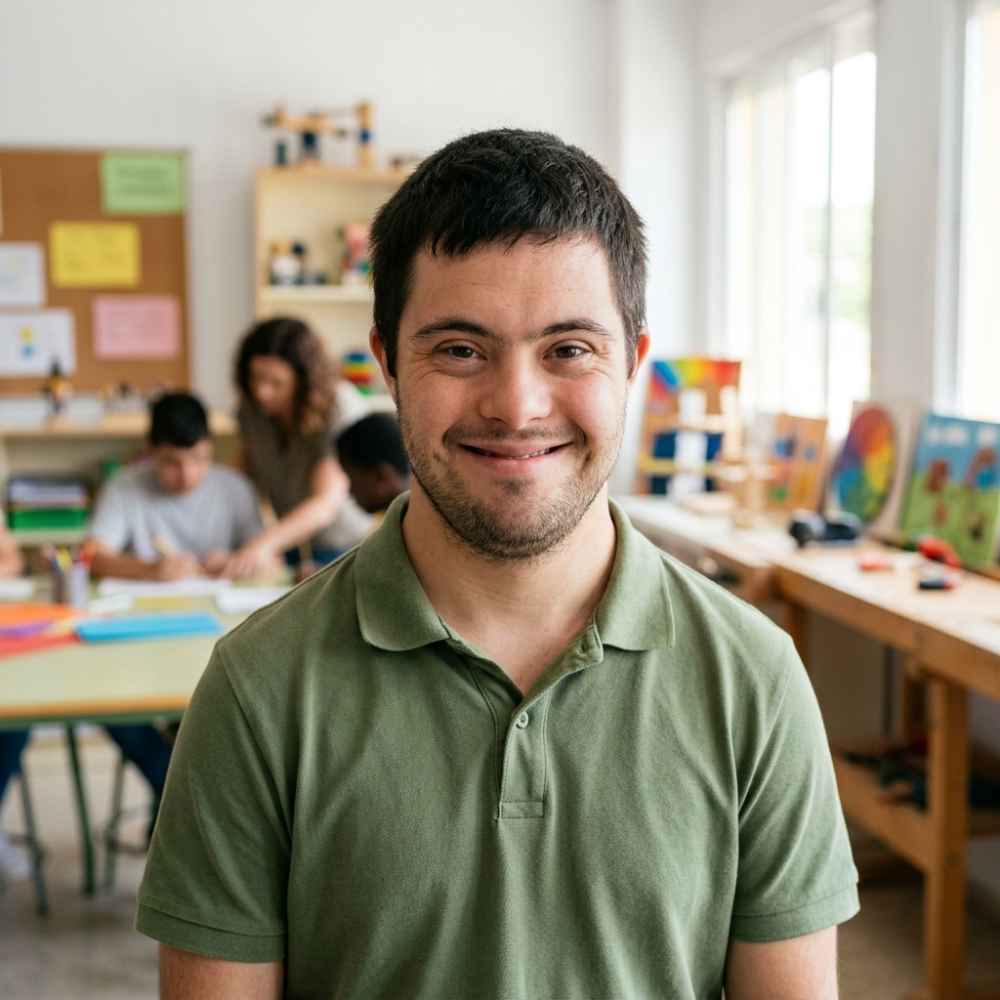
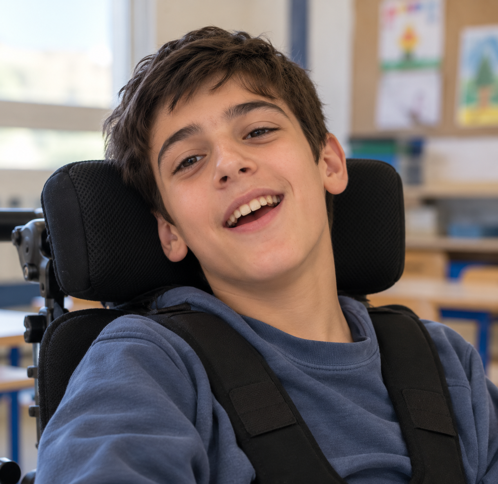
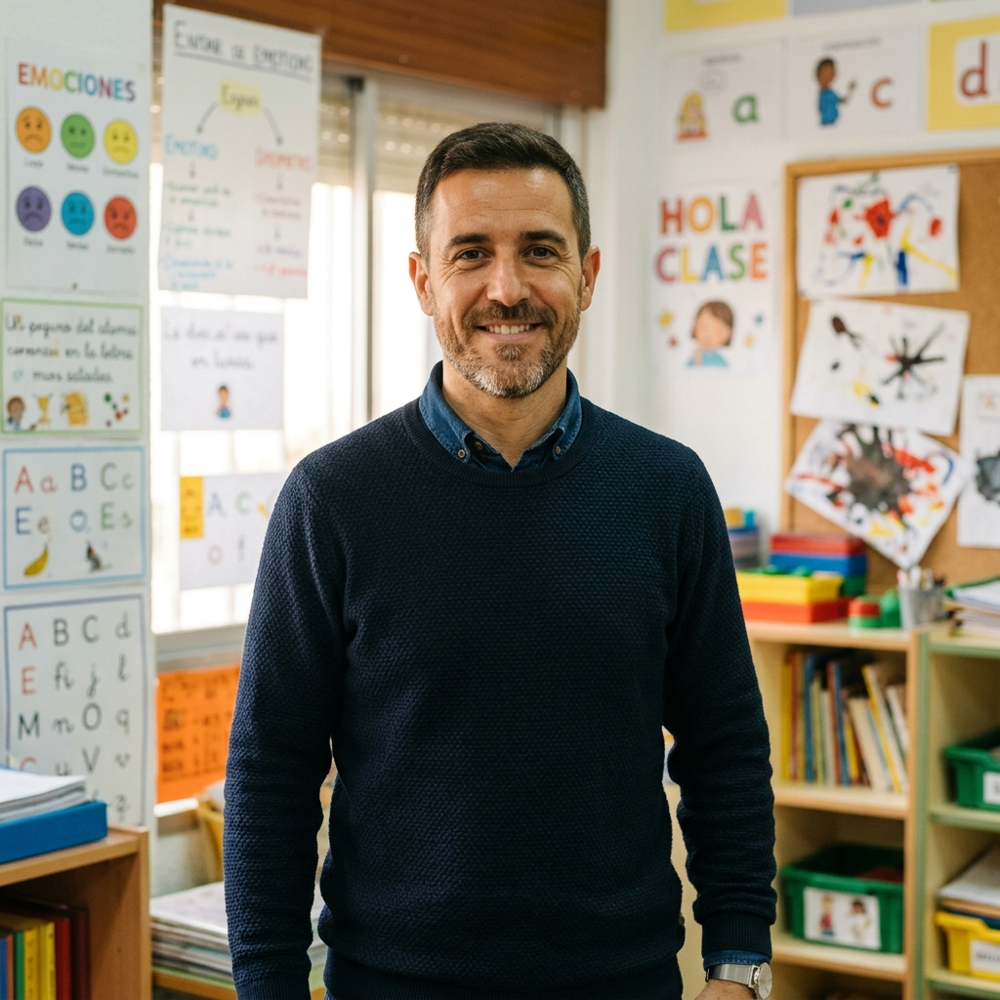
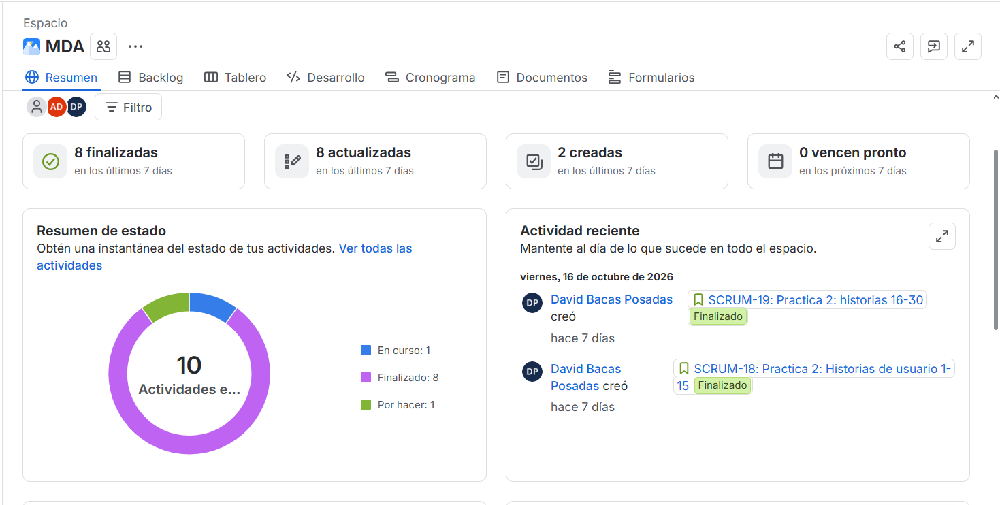

# Metodologías de Desarrollo Ágil (MDA) — Memoria Integral

**Universidad de Granada — Grado en Ingeniería Informática · Curso 2026–2027**  
**Proyecto:** Agenda Accesible — Proyecto AUTOVIDA (26-175)  
**Subtítulo:** Agenda Virtual Accesible  
*Memoria integral de prácticas, especificación centrada en el usuario y desarrollo ágil para el Colegio de Educación Especial Fundación Purísima Concepción de Granada.*

### Información del Proyecto
- **Autoría MDA (4 integrantes firmantes):**
  - David Bacas Posadas
  - Manuel José Fernández Poyatos
  - Alberto David Gómez Gijón
  - Paula Cobos González
- **Grupo ampliado DGP:** 6 integrantes (+ Adam Ben Chacha y Daniel Viloria Prieto)
- **Entorno destinatario:** Colegio de Educación Especial (CEE) Fundación Purísima Concepción (Granada)
- **Curso académico:** 2026 – 2027

---

## Estructura de la Memoria Integral
Este documento agrupa de forma modular todos los entregables, decisiones de diseño y artefactos del desarrollo ágil elaborados para la asignatura Metodologías de Desarrollo Ágil (MDA), coordinada con Dirección y Gestión de Proyectos (DGP).

### Índice

1. [Práctica 0: Problema, Equipo y Reparto de Roles](#1-práctica-0-problema-equipo-y-reparto-de-roles) (pág. 1)
   - 1.1. [Problema que aborda la aplicación](#11-problema-que-aborda-la-aplicación)
   - 1.2. [Presentación del Equipo de Trabajo](#12-presentación-del-equipo-de-trabajo)
   - 1.3. [Rotación de roles del equipo DGP](#13-rotación-de-roles-del-equipo-dgp)
   - 1.4. [Rotación de funciones técnicas](#14-rotación-de-funciones-técnicas)
   - 1.5. [Infraestructura y Herramientas Compartidas](#15-infraestructura-y-herramientas-compartidas)
   - 1.6. [Comunicación y contacto con el Colegio](#16-comunicación-y-contacto-con-el-colegio)
2. [Práctica 1: Personas, Escenarios y Elevator Pitch](#2-práctica-1-personas-escenarios-y-elevator-pitch) (pág. 3)
   - [Ficha de Persona: Carlos Martínez Ruiz](#ficha-de-persona-carlos-martínez-ruiz) (Alumno PTVAL)
   - [Ficha de Persona: Alejandro “Álex” García](#ficha-de-persona-alejandro-álex-garcía) (Alumno PTVAL)
   - [Ficha de Persona: Diego López Martín](#ficha-de-persona-diego-lópez-martín) (Alumno PTVAL)
   - [Ficha de Persona: Samuel Ortega Ruiz](#ficha-de-persona-samuel-ortega-ruiz) (Alumno PTVAL)
   - [Ficha de Persona: Carmen Fernández Delgado](#ficha-de-persona-carmen-fernández-delgado) (Madre de Alumno PTVAL)
   - [Ficha de Persona: Javier Morales Benítez](#ficha-de-persona-javier-morales-benítez) (Tutor Docente PTVAL)
   - [Ficha de Persona: Lucía Romero Vega](#ficha-de-persona-lucía-romero-vega) (Administradora del Sistema)
   - 2.1. [Elevator Pitch](#21-elevator-pitch) (pág. 10)
3. [Práctica 2: Historias de Usuario](#3-práctica-2-historias-de-usuario) (pág. 11)
   - [Product Backlog: Historias HU-01 a HU-31](#historias-de-usuario-product-backlog)
   - 3.1. [Criterios de aceptación de la Iteración 1](#31-criterios-de-aceptación-de-la-iteración-1)
   - 3.2. [Criterios de aceptación de la Iteración 2](#32-criterios-de-aceptación-de-la-iteración-2)
   - [Condiciones transversales de aceptación](#condiciones-transversales-de-aceptación)
   - 3.3. [Alcance aplazado o condicionado](#33-alcance-aplazado-o-condicionado)
   - 3.4. [Plan de entregas](#34-plan-de-entregas) (Tabla 3)
4. [Práctica 4: Registro de horas MDA](#4-registro-de-horas-mda) (pág. 22)
   - [Tabla de dedicación registrada](#dedicación-registrada-al-entregable-mda) (Tabla 4)
   - [Resumen del espacio de trabajo en Jira](#resumen-del-espacio-de-trabajo-en-jira) (Figura 1)

---

## 1. Práctica 0: Problema, Equipo y Reparto de Roles

### 1.1. Problema que aborda la aplicación
El alumnado del Programa de Transición a la Vida Adulta (PTVAL) necesita organizar su tiempo y comprender qué tareas debe realizar, en qué orden y durante cuánto tiempo. Las agendas en papel pueden ser difíciles de mantener actualizadas, mientras que algunas aplicaciones generales ofrecen interfaces poco adaptables a las distintas necesidades de apoyo. Esto puede dificultar la anticipación de rutinas y aumentar la dependencia de recordatorios de otras personas.

AUTOVIDA propone una aplicación para tabletas, personalizable para organizar tareas del centro —como reprografía, comedor, reparto del menú y visitas— y tareas personales. Cada actividad podrá presentarse con imágenes, pictogramas, audio, vídeo o pasos guiados; además, el perfil podrá ajustar la visualización temporal, el acceso a la aplicación y los apoyos de accesibilidad. El objetivo es facilitar la comprensión y realización de las rutinas, y apoyar la coordinación entre alumnado, tutores y familias.

### 1.2. Presentación del Equipo de Trabajo
El proyecto se desarrolla en dos ámbitos de trabajo: el entregable de MDA lo elaboran y firman cuatro integrantes; la coordinación y el reparto de tareas de DGP se realizan entre seis integrantes.

El grupo ampliado de DGP está formado por:
- **David Bacas Posadas**
- **Adam Ben Chacha**
- **Paula Cobos González**
- **Manuel José Fernández Poyatos**
- **Alberto David Gómez Gijón**
- **Daniel Viloria Prieto**

Las tareas y responsabilidades de DGP se distribuyen entre los seis miembros del grupo.

### 1.3. Rotación de roles del equipo DGP
La coordinación, catalogación, moderación y presentación rotan entre iteraciones según la planificación del equipo. Calidad y Usabilidad/Accesibilidad son responsabilidades transversales que se mantienen durante todo el proyecto.

#### Tabla 1: Rotación de roles organizativos del equipo DGP por iteración

| Integrante | Iteración 1 | Iteración 2 | Iteración 3 |
| --- | --- | --- | --- |
| David Bacas Posadas | Coordinador | Presentador | Moderador |
| Alberto David Gómez Gijón | Catalogador | Coordinador | Presentador |
| Manuel José Fernández Poyatos | Moderador | Catalogador | Coordinador |
| Daniel Viloria Prieto | Presentador | Moderador | Catalogador |
| Paula Cobos González | Usabilidad y Accesibilidad | Usabilidad y Accesibilidad | Usabilidad y Accesibilidad |
| Adam Ben Chacha | Gestor de Calidad (QA) | Gestor de Calidad (QA) | Gestor de Calidad (QA) |

### 1.4. Rotación de funciones técnicas
En cada iteración, además del rol organizativo, cada integrante lidera una función técnica. Paula mantiene Usabilidad y Accesibilidad y Adam la responsabilidad de Calidad (QA) durante las tres iteraciones; ambos también rotan por las funciones técnicas.

#### Tabla 2: Rotación de funciones técnicas del equipo DGP por iteración

| Integrante | Iteración 1 | Iteración 2 | Iteración 3 |
| --- | --- | --- | --- |
| David Bacas Posadas | Planificación y Documentación | Implementación y Pruebas | Especificación y Diseño |
| Alberto David Gómez Gijón | Planificación y Documentación | Especificación y Diseño | Implementación y Pruebas |
| Manuel José Fernández Poyatos | Especificación y Diseño | Planificación y Documentación | Implementación y Pruebas |
| Daniel Viloria Prieto | Especificación y Diseño | Implementación y Pruebas | Planificación y Documentación |
| Paula Cobos González | Implementación y Pruebas | Especificación y Diseño | Planificación y Documentación |
| Adam Ben Chacha | Implementación y Pruebas | Planificación y Documentación | Especificación y Diseño |

### 1.5. Infraestructura y Herramientas Compartidas
- **Control de Versiones:** Repositorio en GitHub con flujo de ramas por funcionalidad (*feature branches*); cada pull request debe ser revisada por al menos otra persona del equipo.
- **Gestión Ágil:** Jira Software se utiliza, por ahora, para registrar las tareas pendientes y marcar las que se han completado; el equipo todavía se está familiarizando con la herramienta.
- **Prototipado Visual:** Espacio de trabajo en Figma para elaborar bocetos internos y revisar contrastes y flujos de pantalla con el equipo; los avances se revisan con el profesorado.
- **Tecnología de la aplicación:** Flutter/Dart para tabletas Android e iOS; Firebase Authentication, Cloud Firestore en región UE, Cloud Storage y Cloud Messaging; integración con la API de ARASAAC.
- **Comunicación interna:** WhatsApp para avisos rápidos, Discord para trabajo conjunto y Google Meet para reuniones de coordinación.
- **Documentación:** Markdown para notas y apoyo en el repositorio, LaTeX para los documentos entregables y Dart Doc para las bibliotecas públicas.

### 1.6. Comunicación y contacto con el Colegio
La dirección del Colegio es el cliente real. La recogida inicial de requisitos se realizó mediante una entrevista el 25 de septiembre de 2026 y una visita al centro el 2 de octubre de 2026. No se prevén reuniones ni demostraciones intermedias con el Colegio: las dudas se agrupan y canalizan a través del profesorado. El equipo se reúne semanalmente con el docente en la sesión de prácticas e informa del trabajo y la dedicación de cada integrante. Al cierre de cada iteración le demuestra el incremento, simulando una revisión con el cliente. El Catalogador redacta el acta de cada reunión. Por ahora, en Jira solo se registran las tareas acordadas y se marca cuáles se han completado. El siguiente contacto directo con el Colegio será la presentación final del proyecto.

---

## 2. Práctica 1: Personas, Escenarios y Elevator Pitch

### Ficha de Persona: Carlos Martínez Ruiz
**Perfil:** Alumno PTVAL | **Entorno:** CEE Purísima Concepción  
**Metodología DCU — Alumnado** | Curso 2026/2027

> *«Comprendo todo lo que hay que hacer y quiero ser independiente, pero mis manos no me obedecen con pantallas táctiles pequeñas; necesito botones grandes o un pulsador externo.»*

- **1. Características demográficas:**
  - **Edad y género:** 18 años, varón.
  - **Ubicación:** Granada capital (domicilio familiar).
- **2. Experiencia informática:**
  - **Habilidades informáticas:** Manejo táctil asistido y uso de joystick en su silla. No realiza pinza fina ni tecleo rápido.
  - **Años de experiencia:** 6 años manejando tablets y ordenadores adaptados.
  - **Hábitos de uso:** Navegación web, dictado por voz, consumo de vídeos y mensajería adaptada.
  - **Autonomía digital:** Muy alta si la app ofrece botones grandes o pulsador.
- **3. Experiencia con productos similares:**
  - **Productos similares:** Ha probado agendas digitales estándar en móvil.
  - **Limitaciones actuales:** Los botones pequeños y los gestos táctiles le provocan toques involuntarios por espasmos.
  - **Tendencias de uso:** Prefiere interfaces limpias con opción de pulsador adaptado.
- **4. Tareas (primarias y secundarias):**
  - **Tareas Primarias:** 1) Login con botón grande → 2) Consultar la tarea rotativa del día (visitas, comedor, material) → 3) Ejecutar los pasos guiados con la tablet → 4) Confirmar tarea con pulsador.
- **5. Conocimiento del dominio:**
  - **Comprensión del área:** Conoce al detalle todas las aulas, talleres y personal del centro.
  - **Comprensión temporal:** Completa; entiende horas y minutos estándar, pero agradece un temporizador gráfico.
  - **Destreza procedimental:** Gran capacidad para realizar tareas del centro con apoyo técnico accesible.
- **6. Tecnología disponible:**
  - **Hardware:** Tablet Android y pulsador externo.
  - **Software:** Aplicación de agenda para tableta Android.
  - **Herramientas habituales:** Conexión Wi-Fi.
- **7. Actitudes y valores:**
  - **Preferencias:** Interfaz clara, adulta y no infantilizada, con respuesta rápida.
  - **Miedo a la tecnología:** Ninguno; siente frustración si la interfaz es pequeña y le obliga a pedir ayuda física.
  - **Valores:** Orgullo por su autonomía y por participar en las tareas rotativas del centro.
- **8. Estilo de aprendizaje:**
  - **Perfil de aprendizaje:** Cognitivo estándar.
  - **Canales óptimos:** Iconos claros, texto legible, vídeos explicativos y sonido de confirmación.
  - **Metodología:** Asimilación directa; requiere únicamente adaptación física de entrada.
- **9. Criticidad de los errores:**
  - **Consecuencias de un error:** *Emocional:* Frustración e impotencia al no poder pulsar el control deseado. *Operativo:* Pulsación involuntaria por espasmo que marque una tarea sin terminar.
  - **Tolerancia del software:** Filtro antitemblor (retardo de pulsación), botones grandes y confirmación antes de desmarcar tareas.
- **Escenario de Uso Contextual (Día típico):**  
  A las 11:00 h, Carlos recibe un aviso en su tableta. La aplicación le indica su tarea rotativa de hoy: acompañar al grupo de visitas escolares. Consulta en la pantalla los pasos y apoyos visuales de cada aula y presiona su pulsador para marcar cada hito como completado.
- **Ajustes de Interfaz Accesible:**  
  - Pulsador Externo / Botones Grandes
  - Filtro Antitemblor

---

### Ficha de Persona: Alejandro “Álex” García
**Perfil:** Alumno PTVAL | **Entorno:** CEE Purísima Concepción  
**Metodología DCU — Alumnado** | Curso 2026/2027

> *«Necesito saber con imágenes qué tengo que hacer después y cuánto tiempo me queda para no ponerme nervioso ni perderme en los pasillos.»*

- **1. Características demográficas:**
  - **Edad y género:** 19 años, varón.
  - **Ubicación:** Granada capital (domicilio familiar).
- **2. Experiencia informática:**
  - **Habilidades informáticas:** Nivel básico táctil asistido. No usa ratón ni teclado.
  - **Años de experiencia:** 5 años usando tablets en el aula.
  - **Hábitos de uso:** Navegación por fotos de contactos, vídeos y juegos de emparejamiento.
  - **Autonomía digital:** Buena en pantallas con pocas opciones claras.
- **3. Experiencia con productos similares:**
  - **Productos similares:** Paneles físicos de velcro (PECS) y app DictaPicto.
  - **Limitaciones actuales:** Las tarjetas físicas de papel se pierden; las apps habituales tienen mucho texto o menús complejos.
  - **Tendencias de uso:** Gran adherencia a apoyos con imágenes y sonidos.
- **4. Tareas (primarias y secundarias):**
  - **Tareas Primarias:** 1) Login tocando su foto → 2) Consultar la tarea rotativa asignada (reprografía, comedor, orden) → 3) Seguir los pasos guiados con imágenes → 4) Confirmar paso verde.
  - **Tareas Secundarias:** Mirar cuánto falta para el recreo; pedir ayuda al tutor.
- **5. Conocimiento del dominio:**
  - **Comprensión del área:** Conoce las rutinas del colegio, las aulas y a los maestros.
  - **Comprensión temporal:** Relativa visual (“ahora”, “después”). No interpreta números de reloj convencional.
  - **Destreza procedimental:** Ejecuta tareas escolares paso a paso de forma autónoma con apoyo de imágenes.
- **6. Tecnología disponible:**
  - **Hardware:** Tablet Android.
  - **Software:** Síntesis de voz.
  - **Herramientas habituales:** Conexión Wi-Fi.
- **7. Actitudes y valores:**
  - **Preferencias:** Refuerzos sonoros alegres (aplausos) y pantallas con una sola idea.
  - **Miedo a la tecnología:** Nulo temor a tocar; ansiedad ante pitidos de error o bloqueos de la aplicación.
  - **Valores:** Gran satisfacción por sentirse útil participando en las tareas del colegio.
- **8. Estilo de aprendizaje:**
  - **Perfil de aprendizaje:** Visual estricto reforzado por canal Auditivo (TTS).
  - **Canales óptimos:** Pictogramas ARASAAC y fotos reales de profesores y aulas.
  - **Metodología:** Modelado, ensayo guiado (*learning by doing*) y refuerzo inmediato.
- **9. Criticidad de los errores:**
  - **Consecuencias de un error:** *Emocional:* Desorientación, ansiedad y bloqueo con llanto o rechazo. *Operativo:* Confusión de aulas o retraso en las entregas.
  - **Tolerancia del software:** Extrema. Sin acciones destructivas, confirmación asistida y botón de ayuda permanente.
- **Escenario de Uso Contextual (Día típico):**  
  A las 10:15h, la tablet emite una melodía suave. Álex toca su foto y descubre su tarea rotativa de la semana: reprografía. Sigue los pasos guiados con fotos de profesores, recoge los folios y pulsa el botón verde. Tras repartir las copias, la pantalla celebra su éxito con un aplauso sonoro y suma una estrella a su casillero.
- **Ajustes de Interfaz Accesible:**  
  - Login Foto / Color
  - ARASAAC + Fotos Reales
  - Síntesis de Voz (TTS)

---

### Ficha de Persona: Diego López Martín
**Perfil:** Alumno PTVAL | **Entorno:** CEE Purísima Concepción  
**Metodología DCU — Alumnado** | Curso 2026/2027

> *«Me ayuda saber qué va a pasar y ver cada paso con claridad. Si hay un cambio, necesito que me lo expliquen antes y con calma.»*

- **1. Características demográficas:**
  - **Edad y género:** 16 años, varón.
  - **Ubicación:** Granada capital.
- **2. Experiencia informática:**
  - **Habilidades informáticas:** Manejo táctil autónomo con iconos conocidos.
  - **Experiencia:** Usa tablet en el aula con apoyo ocasional.
  - **Autonomía digital:** Buena en pantallas previsibles, con pocas opciones.
- **3. Experiencia con productos similares:**
  - **Productos similares:** Agenda visual en papel y pictogramas.
  - **Limitaciones actuales:** Le cuesta seguir cambios comunicados solo oralmente.
  - **Preferencias de uso:** Secuencias estables, fotos conocidas y avisos anticipados.
- **4. Tareas (primarias y secundarias):**
  - **Tareas Primarias:** 1) Abrir su agenda → 2) Ver qué toca ahora y después → 3) Seguir pasos visuales → 4) Marcar tarea terminada.
  - **Tareas Secundarias:** Consultar un cambio y pedir ayuda.
- **5. Conocimiento del dominio:**
  - **Comprensión del área:** Reconoce espacios y personas habituales del centro.
  - **Comprensión temporal:** Comprende mejor “ahora/después” con apoyos visuales.
  - **Destreza procedimental:** Realiza rutinas conocidas con una instrucción cada vez.
- **6. Tecnología disponible:**
  - **Hardware:** Tablet Android con funda protectora.
  - **Software:** Agenda visual con pictogramas, fotos y voz opcional.
  - **Herramientas habituales:** Auriculares disponibles si el entorno está ruidoso.
- **7. Actitudes y valores:**
  - **Preferencias:** Diseño tranquilo, consistente y sin animaciones inesperadas.
  - **Necesidad de apoyo:** Aviso previo y explicación visual ante cambios.
  - **Motivación:** Elegir entre opciones conocidas y completar rutinas por sí mismo.
- **8. Estilo de aprendizaje:**
  - **Perfil de aprendizaje:** Predominio visual; respuesta variable al canal auditivo.
  - **Canales óptimos:** Fotos reales, pictogramas y frases breves.
  - **Metodología:** Anticipación, modelado y práctica gradual.
- **9. Criticidad de los errores:**
  - **Consecuencias de un error:** Un cambio inesperado o una pantalla confusa puede generar ansiedad y detener la actividad.
  - **Tolerancia del software:** Cambios señalados con antelación, opción de volver atrás y ayuda visible.
- **Escenario de Uso Contextual (Día típico):**  
  Antes de cambiar de aula, Diego consulta la agenda y ve una foto del espacio siguiente. Si se modifica la rutina, el tutor actualiza la secuencia y se la muestra con antelación. Diego revisa el primer paso y continúa acompañado solo cuando lo necesita.
- **Ajustes de Interfaz Accesible:**  
  - Apoyo Visual
  - Pasos Breves
  - Anticipación de Cambios

---

### Ficha de Persona: Samuel Ortega Ruiz
**Perfil:** Alumno PTVAL | **Entorno:** CEE Purísima Concepción  
**Metodología DCU — Alumnado** | Curso 2026/2027

> *«Necesito tiempo para responder. Me ayuda que me habléis con frases cortas y pueda señalar una imagen para decir lo que quiero.»*

- **1. Características demográficas:**
  - **Edad y género:** 17 años, varón.
  - **Ubicación:** Granada capital.
- **2. Experiencia informática:**
  - **Habilidades informáticas:** Acceso mediante pulsador adaptado y barrido asistido.
  - **Experiencia:** Usa comunicador y tablet con acompañamiento.
  - **Autonomía digital:** Variable; necesita tiempo de respuesta y apoyo para navegar.
- **3. Experiencia con productos similares:**
  - **Productos similares:** Tablero de comunicación y comunicador con pictogramas.
  - **Limitaciones actuales:** Interfaces táctiles pequeñas y mensajes con demasiados pasos.
  - **Preferencias de uso:** Opciones visibles, selección accesible y confirmación de lo elegido.
- **4. Tareas (primarias y secundarias):**
  - **Tareas Primarias:** 1) Acceder con ayuda → 2) Elegir actividad entre opciones visuales → 3) Ver un paso cada vez → 4) Confirmar con pulsador o mirada.
  - **Tareas Secundarias:** Comunicar “ayuda”, “descanso” o “no”.
- **5. Conocimiento del dominio:**
  - **Comprensión del área:** Reconoce personas y lugares familiares con fotos.
  - **Comprensión de instrucciones:** Mejor con frases sencillas, demostración y tiempo para procesar.
  - **Destreza procedimental:** Participa en rutinas con apoyos comunicativos y asistencia física cuando hace falta.
- **6. Tecnología disponible:**
  - **Hardware:** Tablet montada en soporte y pulsador adaptado.
  - **Software:** Comunicador aumentativo con salida de voz.
  - **Herramientas habituales:** Barrido asistido y acceso por mirada si está disponible.
- **7. Actitudes y valores:**
  - **Preferencias:** Ritmo pausado y tiempo suficiente para responder.
  - **Necesidad de apoyo:** No interpretar la falta de respuesta inmediata como falta de comprensión.
  - **Motivación:** Poder expresar elecciones, necesidades y rechazo.
- **8. Estilo de aprendizaje:**
  - **Perfil de aprendizaje:** Apoyo visual y comunicación multimodal.
  - **Canales óptimos:** Fotos, pictogramas, demostración y voz sintetizada.
  - **Metodología:** Instrucciones de un paso, espera y comprobación de comprensión.
- **9. Criticidad de los errores:**
  - **Consecuencias de un error:** Una elección mal interpretada puede impedirle comunicar una necesidad o completar la actividad.
  - **Tolerancia del software:** No depender solo de respuestas orales; permitir repetir, cancelar y solicitar ayuda.
- **Escenario de Uso Contextual (Día típico):**  
  Durante una actividad, Samuel consulta una pantalla con una sola instrucción y fotos conocidas. Selecciona su respuesta mediante el pulsador; la app la reproduce en voz alta y espera su confirmación. Si necesita parar, elige el pictograma de descanso y el tutor ajusta la tarea.
- **Ajustes de Interfaz Accesible:**  
  - Pulsador Adaptado
  - Comunicación Aumentativa
  - Tiempo de Respuesta Ampliado

---

### Ficha de Persona: Carmen Fernández Delgado
**Perfil:** Madre de Alumno PTVAL | **Coordinación del Hogar**  
**Entorno Familiar | Granada** | Curso 2026/2027

> *«Quiero que la autonomía que Carlos gana en el colegio continúe en casa; necesito una agenda donde podamos programar sus rutinas de la tarde sin que suponga otra carga técnica inasumible tras mi jornada laboral.»*

- **1. Características demográficas:**
  - **Edad y Género:** 46 años, Mujer.
  - **Ubicación:** Granada capital (barrio Zaidín).
  - **Situación familiar:** Madre de Carlos (alumno con discapacidad motriz). Cuidadora principal.
- **2. Experiencia profesional:**
  - **Puesto actual:** Administrativa contable en empresa local (jornada continua).
  - **Antigüedad:** 15 años en la empresa | 18 años como madre y cuidadora.
  - **Responsabilidades:** Conciliación laboral y familiar, coordinación de fisioterapia semanal y apoyo en el hogar.
- **3. Formación:**
  - **Titulación:** Diplomatura en Ciencias Empresariales.
  - **Especialidad:** Gestión contable y financiera.
  - **Cursos realizados:** Talleres de escuela de familias sobre productos de apoyo y autonomía en el hogar.
- **4. Experiencia informática:**
  - **Habilidades informáticas:** Nivel usuario medio en smartphone y ordenador.
  - **Años de experiencia:** +16 años utilizando dispositivos digitales.
  - **Hábitos de uso:** Uso diario de apps de mensajería, trámites online y banca móvil.
- **5. Experiencia con productos similares:**
  - **Productos similares:** Agendas de papel escolar, notas en la nevera y calendario del móvil.
  - **Limitaciones actuales:** Los calendarios convencionales no están adaptados a su hijo y las notas en papel se pierden.
- **6. Tareas (primarias y secundarias):**
  - **Tareas Primarias:** 1) Consultar en la tableta las tareas escolares de Carlos → 2) Programar las rutinas de la tarde en casa o fuera de casa → 3) Añadir fotos cotidianas a los pasos → 4) Supervisar el progreso y la finalización de tareas.
- **7-8. Autonomía y apoyos de Carlos:**
  - **Edad y perfil:** Carlos tiene 18 años y discapacidad motriz; utiliza silla de ruedas.
  - **En el colegio:** Puede desplazarse por recorridos conocidos y completar tareas rutinarias (consultar pasos y confirmar hitos) con tablet y pulsador, si los espacios son accesibles.
  - **Fuera del colegio:** Puede seguir rutinas familiares conocidas con la agenda en la tablet; puede necesitar ayuda en desplazamientos no conocidos y tareas que requieran manipulación física. Carmen adapta las actividades a su fatiga y busca fomentar su autonomía.
  - **Apoyos disponibles:** Tableta Android y pulsador para Carlos; aplicación en tableta para que Carmen programe y supervise las rutinas.
- **9. Actitudes y valores:**
  - **Preferencias:** Interfaz rápida, directa, sin configuraciones farragosas y con sincronización en tiempo real.
  - **Miedo a la tecnología:** Preocupación por caídas de conexión que desorienten a su hijo al llegar a casa.
  - **Valores:** Bienestar emocional de su hijo e impulso a su independencia personal.
- **10. Estilo de aprendizaje:**
  - **Perfil de aprendizaje:** Práctico y funcional; resolución directa de tareas cotidianas.
  - **Canales óptimos:** Interfaz clara e intuitiva sin necesidad de manuales extensos.
  - **Curva de adopción:** Inmediata si comprueba que su hijo usa la agenda en casa sin frustración.
- **11. Criticidad de los errores:**
  - **Consecuencias de un error:** *Logístico/Familiar:* Olvido de una rutina de fisioterapia o merienda. *Emocional:* Estrés y sobrecarga tras la jornada laboral.
  - **Tolerancia del software:** Guardado local ante fallos de cobertura y sincronización en la nube.
- **Escenario de Uso Contextual (Día típico):**  
  A las 16:30h al salir de la oficina, Carmen consulta la aplicación en su tableta y comprueba que Carlos completó con éxito su tarea rotativa de la mañana. Después programa la rutina de la tarde: “17:30h - Merienda” y “18:15h - Preparar mochila de fisioterapia” con fotos de la mochila azul. Carlos consulta las tareas en su tableta.
- **Rol y Funciones en Plataforma:**  
  - App Familiar en Tableta
  - Rutinas del Hogar
  - Sincronización Centro-Casa

---

### Ficha de Persona: Javier Morales Benítez
**Perfil:** Tutor Docente PTVAL | **Coordinación de Aula**  
**CEE Purísima Concepción** | Curso 2026/2027

> *«Gestiono un aula heterogénea con diferentes niveles de autonomía. Necesito organizar el día de cada alumno en minutos antes de las 9:00, asignar las tareas rotativas de reprografía o comedor, y tener la certeza de que el sistema avisa a cocina sin errores.»*

- **1. Características demográficas:**
  - **Edad y Género:** 39 años, Varón.
  - **Ubicación:** Granada capital.
  - **Perfil profesional:** Maestro especialista en Pedagogía Terapéutica (PT) con 12 años de experiencia docente, 5 en el CEE Purísima Concepción.
- **2. Experiencia profesional:**
  - **Puesto actual:** Tutor de Aula del Programa de Transición a la Vida Adulta (PTVAL).
  - **Antigüedad:** 12 años en educación especial | 5 años en el centro actual.
  - **Responsabilidades:** Planificar itinerarios de autonomía, asignar roles de centro (reprografía, comedor), coordinar con familias y velar por la seguridad del aula.
- **3. Formación:**
  - **Titulación:** Grado en Educación Primaria (Mención Pedagogía Terapéutica).
  - **Especialidad:** Pedagogía Terapéutica y Audición y Lenguaje (AL).
  - **Cursos realizados:** Formación continua en TIC accesibles, sistemas SAAC y metodologías de inclusión laboral.
- **4. Experiencia informática:**
  - **Habilidades informáticas:** Nivel avanzado en herramientas educativas digitales y pictogramas ARASAAC.
  - **Años de experiencia:** +15 años gestionando plataformas digitales y pizarras interactivas.
  - **Hábitos de uso:** Uso continuo de ordenador portátil, tablet y smartphone.
- **5. Experiencia con productos similares:**
  - **Productos similares:** Portales de pictogramas, hojas de cálculo para el comedor y paneles físicos de aula.
  - **Limitaciones actuales:** Pérdida de tiempo recortando velcros y falta de seguimiento en tiempo real fuera del aula.
- **6. Tareas (primarias y secundarias):**
  - **Tareas Primarias:** 1) Configurar tareas diarias antes de la asamblea → 2) Asignar encargos rotativos del día a los alumnos → 3) Supervisar el estado del circuito → 4) Validar listado de comedor para cocina.
  - **Tareas Secundarias:** Dar mensajes de refuerzo al alumnado durante las actividades.
- **7. Conocimiento del dominio:**
  - **Comprensión del área:** Experto en didáctica adaptada, diversidad cognitiva y motriz, sistemas SAAC y anticipación temporal.
  - **Conocimiento del grupo:** Conoce el umbral de tolerancia a la frustración y ritmos de cada uno de sus alumnos.
- **8. Tecnología disponible:**
  - **Hardware:** Tableta del centro y ordenador portátil para otras tareas.
  - **Software:** Aplicación para tableta Android o iOS.
  - **Herramientas:** Red Wi-Fi.
- **9. Actitudes y valores:**
  - **Preferencias:** Software ágil, paneles limpios tipo dashboard sin pasos redundantes y visión del aula en un vistazo.
  - **Miedo a la tecnología:** Preocupación por caídas de red que dejen a los alumnos sin soporte visual durante la jornada.
  - **Valores:** Compromiso con la inclusión y la capacitación laboral de sus alumnos.
- **10. Estilo de aprendizaje:**
  - **Perfil de aprendizaje:** Analítico, estructurado y visual.
  - **Canales óptimos:** Paneles de control con tarjetas de estado y tablas dinámicas.
  - **Adopción:** Rápida si ahorra tiempo administrativo en la gestión del aula.
- **11. Criticidad de los errores:**
  - **Consecuencias de un error:** *Logístico y de Salud:* Notificar erróneamente dietas de comedor (alergias o celiaquía). *Conductual:* Desajuste horario que provoque crisis de ansiedad en el alumno.
  - **Tolerancia del software:** Confirmación obligatoria para dietas de comedor y registro histórico de cambios.
- **Escenario de Uso Contextual (Día típico):**  
  A las 8:40h antes de que lleguen los alumnos, Javier abre la aplicación en la tableta del centro. En dos minutos distribuye los encargos rotativos del día (reprografía a Álex, visitas a Carlos) con las fotos y apoyos asignados. A las 10:20h consulta el progreso de las tareas y valida el listado de comensales para cocina.
- **Rol y Funciones en Plataforma:**  
  - App Docente en Tableta
  - Asignación de Rutinas
  - Monitorización Directo

---

### Ficha de Persona: Lucía Romero Vega
**Perfil:** Administradora del Sistema | **Seguridad y Soporte**  
**CEE Purísima Concepción** | Curso 2026/2027

> *«Necesito gestionar usuarios y permisos de forma segura, resolver incidencias sin interrumpir las rutinas del alumnado y saber que los datos están protegidos y respaldados.»*

- **1. Características demográficas:**
  - **Edad y Género:** 36 años, mujer.
  - **Ubicación:** Granada capital.
  - **Perfil:** Profesional responsable de la administración técnica de la plataforma en el centro.
- **2. Experiencia profesional:**
  - **Puesto actual:** Administradora de sistemas y soporte TIC.
  - **Antigüedad:** 8 años en soporte tecnológico; 3 en el centro.
  - **Responsabilidades:** Gestionar cuentas, permisos, configuración, copias de seguridad e incidencias.
- **3. Formación:**
  - **Titulación:** CFGS en Administración de Sistemas Informáticos en Red.
  - **Especialidad:** Redes, gestión de identidades y seguridad de sistemas.
  - **Formación:** Protección de datos y buenas prácticas de ciberseguridad.
- **4. Experiencia informática:**
  - **Habilidades informáticas:** Avanzadas en gestión de plataformas, redes y control de accesos.
  - **Experiencia:** 8 años administrando servicios digitales.
  - **Hábitos:** Revisa alertas, incidencias, registros y estado de las copias.
- **5. Experiencia con productos similares:**
  - **Productos similares:** Aplicaciones de administración para tableta y sistemas de tickets.
  - **Limitaciones actuales:** Permisos dispersos y solicitudes urgentes por canales informales.
  - **Expectativas:** Gestión centralizada, trazabilidad y avisos claros ante fallos.
- **6. Tareas (primarias y secundarias):**
  - **Tareas Primarias:** 1) Crear o desactivar cuentas → 2) Asignar permisos mínimos → 3) Revisar incidencias y registros → 4) Comprobar copias de seguridad.
  - **Tareas Secundarias:** Ayudar a docentes con accesos y recuperar el servicio ante una caída.
- **7. Conocimiento del dominio:**
  - **Comprensión del área:** Conoce la gestión de identidades, permisos y continuidad del servicio.
  - **Contexto del centro:** Debe proteger datos sensibles y evitar interrupciones en las rutinas de apoyo.
- **8. Tecnología disponible:**
  - **Hardware:** Tableta de administración.
  - **Software:** Aplicación de administración en tableta, gestor de contraseñas y sistema de tickets.
  - **Seguridad:** Buenas prácticas de seguridad; la autenticación multifactor se recomienda cuando esté disponible.
- **9. Actitudes y valores:**
  - **Preferencias:** Panel claro, acciones reversibles y permisos definidos por rol.
  - **Preocupaciones:** Acceso indebido, pérdida de datos o cambios sin registrar.
  - **Valores:** Privacidad, disponibilidad y mínimo privilegio.
- **10. Estilo de aprendizaje:**
  - **Perfil de aprendizaje:** Técnico, metódico y orientado a procedimientos.
  - **Canales óptimos:** Registros detallados, alertas accionables y documentación breve.
  - **Adopción:** Rápida si la aplicación en tableta centraliza tareas y facilita auditorías.
- **11. Criticidad de los errores:**
  - **Consecuencias de un error:** *Seguridad:* Exposición de datos personales. *Operativo:* Bloqueo de cuentas o pérdida de horarios y tareas.
  - **Tolerancia del software:** Confirmación en cambios críticos, registro de auditoría y copias recuperables.
- **Escenario de Uso Contextual (Día típico):**  
  Al inicio de curso, Lucía recibe la solicitud de alta de una docente. Verifica su identidad desde la aplicación en tableta, crea la cuenta con el rol correspondiente y comprueba los permisos. Después registra el cambio y confirma que la copia de seguridad se completó correctamente.
- **Rol y Funciones en Plataforma:**  
  - Control de Accesos
  - Copias de Seguridad
  - Auditoría e Incidencias

---

### 2.1. Elevator Pitch

El Elevator Pitch es una presentación breve del producto que resume a quién se dirige, qué necesidad resuelve y qué lo diferencia de otras soluciones. Lo incluimos para comunicar la propuesta de valor de la agenda de forma clara y directa, poniendo en primer plano las necesidades de las personas usuarias y sus familias.

> **«Para el alumnado del PTVAL que necesita anticipar y comprender sus actividades, AUTOVIDA es una aplicación accesible para tableta que organiza tareas personales y del centro y ofrece horarios, avisos y apoyos visuales o audiovisuales paso a paso. A diferencia de un calendario general, permite adaptar la presentación a las preferencias de cada estudiante; los tutores y familiares autorizados pueden configurar sus tareas y consultar su progreso, favoreciendo su autonomía sin sustituir los apoyos que necesite.»**

---

## 3. Práctica 2: Historias de Usuario

### Historias de Usuario (Product Backlog)

#### HU-01: Crear y editar una cuenta de usuario
- **Número:** HU-01
- **Nombre:** Crear y editar una cuenta de usuario
- **Usuario:** Administrador del sistema
- **Modificación de Historia N.º:** 0
- **Iteración asignada:** 1
- **Prioridad en Negocio:** Alta
- **Puntos estimados:** 3
- **Desarrollador Encargado:** Por asignar
- **Descripción:** Como administrador, quiero crear y actualizar las cuentas de tutores y estudiantes, para habilitar y mantener su acceso a la agenda.
- **Observaciones:** La cuenta debe guardar los datos identificativos necesarios y no duplicar un usuario existente.

#### HU-02: Asignar un rol de acceso
- **Número:** HU-02
- **Nombre:** Asignar un rol de acceso
- **Usuario:** Administrador del sistema
- **Modificación de Historia N.º:** 0
- **Iteración asignada:** 1
- **Prioridad en Negocio:** Alta
- **Puntos estimados:** 2
- **Desarrollador Encargado:** Por asignar
- **Descripción:** Como administrador, quiero asignar un rol a una cuenta, para limitar sus funciones a las que necesita.
- **Observaciones:** Los roles disponibles son administrador, tutor y estudiante; los permisos deben corresponder al rol seleccionado.

#### HU-03: Gestionar una tarea personal
- **Número:** HU-03
- **Nombre:** Gestionar una tarea personal
- **Usuario:** Estudiante o tutor autorizado (del centro o familiar)
- **Modificación de Historia N.º:** 0
- **Iteración asignada:** 1
- **Prioridad en Negocio:** Alta
- **Puntos estimados:** 3
- **Desarrollador Encargado:** Por asignar
- **Descripción:** Como estudiante o tutor autorizado, quiero crear, modificar y eliminar tareas personales, para organizar las actividades del estudiante.
- **Observaciones:** El familiar actúa como tutor personal autorizado; las tareas quedan asociadas al perfil correcto e incluyen nombre, horario y apoyos accesibles disponibles.

#### HU-04: Definir el horario de una tarea
- **Número:** HU-04
- **Nombre:** Definir el horario de una tarea
- **Usuario:** Tutor o familiar
- **Modificación de Historia N.º:** 0
- **Iteración asignada:** 1
- **Prioridad en Negocio:** Alta
- **Puntos estimados:** 2
- **Desarrollador Encargado:** Por asignar
- **Descripción:** Como tutor o familiar, quiero definir la hora de inicio y fin de una tarea, para que el estudiante sepa cuándo realizarla.
- **Observaciones:** El horario debe mostrarse en la agenda diaria o semanal del estudiante. === PAGE 14 ===

#### HU-05: Añadir información accesible a una tarea
- **Número:** HU-05
- **Nombre:** Añadir información accesible a una tarea
- **Usuario:** Tutor o familiar autorizado
- **Modificación de Historia N.º:** 0
- **Iteración asignada:** 1
- **Prioridad en Negocio:** Alta
- **Puntos estimados:** 2
- **Desarrollador Encargado:** Por asignar
- **Descripción:** Como tutor autorizado, quiero añadir a una tarea una descripción breve y asociar una imagen o pictograma de apoyo, para que el estudiante entienda qué actividad debe realizar.
- **Observaciones:** La descripción y el recurso visual quedan asociados a la tarea; se puede adjuntar una fotografía propia o un pictograma de ARASAAC. Los recursos de audio o vídeo deben estar disponibles previamente y no se graban desde la aplicación.

#### HU-06: Definir instrucciones y, opcionalmente, una ruta de tarea
- **Número:** HU-06
- **Nombre:** Definir instrucciones y, opcionalmente, una ruta de tarea
- **Usuario:** Tutor del centro o tutor personal autorizado
- **Modificación de Historia N.º:** 0
- **Iteración asignada:** 1
- **Prioridad en Negocio:** Alta
- **Puntos estimados:** 3
- **Desarrollador Encargado:** Por asignar
- **Descripción:** Como tutor autorizado, quiero describir los pasos de una tarea y, opcionalmente, su ruta (RF-20), para que el estudiante sepa qué hacer y en qué orden.
- **Observaciones:** Las instrucciones se presentan en pasos comprensibles; si se incluye la función opcional RF-20, la ruta indica lugares o acciones secuenciales, por ejemplo, recoger material en un aula y llevarlo al taller.

#### HU-07: Crear y asignar un encargo del centro
- **Número:** HU-07
- **Nombre:** Crear y asignar un encargo del centro
- **Usuario:** Tutor del centro
- **Modificación de Historia N.º:** 0
- **Iteración asignada:** 1
- **Prioridad en Negocio:** Alta
- **Puntos estimados:** 2
- **Desarrollador Encargado:** Por asignar
- **Descripción:** Como tutor del centro, quiero crear un encargo y asignarlo a uno o varios estudiantes o a un aula para una fecha concreta, para organizar las tareas del centro (RF-16).
- **Observaciones:** El tutor del centro crea el encargo, selecciona uno o varios estudiantes o un aula e indica la fecha; el encargo aparece en la agenda de las personas asignadas.

#### HU-08: Iniciar sesión de forma accesible
- **Número:** HU-08
- **Nombre:** Iniciar sesión de forma accesible
- **Usuario:** Estudiante (Alejandro “Álex” García)
- **Modificación de Historia N.º:** 0
- **Iteración asignada:** 1
- **Prioridad en Negocio:** Alta
- **Puntos estimados:** 3
- **Desarrollador Encargado:** Por asignar
- **Descripción:** Como estudiante, quiero iniciar sesión mediante el método accesible configurado para mí, para entrar en mi agenda de forma autónoma.
- **Observaciones:** El sistema ofrecerá el método asociado a la cuenta y confirmará claramente si el acceso se ha realizado. === PAGE 15 ===

#### HU-09: Consultar la agenda diaria o semanal
- **Número:** HU-09
- **Nombre:** Consultar la agenda diaria o semanal
- **Usuario:** Estudiante (Diego López Martín)
- **Modificación de Historia N.º:** 0
- **Iteración asignada:** 1
- **Prioridad en Negocio:** Alta
- **Puntos estimados:** 2
- **Desarrollador Encargado:** Por asignar
- **Descripción:** Como estudiante, quiero consultar mi agenda en modo diario o semanal, para saber qué actividades tengo programadas y cuándo realizarlas (RF-23).
- **Observaciones:** La agenda muestra las tareas personales y del centro ordenadas por horario. Como ampliación opcional (RF-24), puede cubrir la jornada completa e incluir tareas del hogar.

#### HU-10: Anticipar la siguiente tarea
- **Número:** HU-10
- **Nombre:** Anticipar la siguiente tarea
- **Usuario:** Estudiante (Diego López Martín)
- **Modificación de Historia N.º:** 0
- **Iteración asignada:** 1
- **Prioridad en Negocio:** Alta
- **Puntos estimados:** 1
- **Desarrollador Encargado:** Por asignar
- **Descripción:** Como estudiante, quiero ver cuál será mi siguiente tarea, para prepararme para el cambio de actividad.
- **Observaciones:** La siguiente tarea se distinguirá de la tarea actual y se actualizará al completar la actividad.

#### HU-11: Registrar el inicio y fin de una tarea
- **Número:** HU-11
- **Nombre:** Registrar el inicio y fin de una tarea
- **Usuario:** Estudiante (Carlos Martínez Ruiz)
- **Modificación de Historia N.º:** 0
- **Iteración asignada:** 1
- **Prioridad en Negocio:** Alta
- **Puntos estimados:** 1
- **Desarrollador Encargado:** Por asignar
- **Descripción:** Como estudiante, quiero indicar cuándo empiezo y termino una tarea, para que mi progreso quede registrado.
- **Observaciones:** Antes de registrar el inicio o la finalización, el sistema solicita una confirmación accesible; si se cancela, el estado no cambia. Tras confirmar, registra el estado correspondiente (RF-26); el refuerzo positivo (RF-28) es opcional.

#### HU-12: Desactivar una cuenta
- **Número:** HU-12
- **Nombre:** Desactivar una cuenta
- **Usuario:** Administrador del sistema
- **Modificación de Historia N.º:** 0
- **Iteración asignada:** 2
- **Prioridad en Negocio:** Alta
- **Puntos estimados:** 1
- **Desarrollador Encargado:** Por asignar
- **Descripción:** Como administrador, quiero desactivar una cuenta, para retirar el acceso cuando su usuario deje de utilizar el sistema.
- **Observaciones:** La cuenta desactivada no podrá iniciar sesión y su registro se conservará para trazabilidad.

#### HU-13: Configurar repetición semanal
- **Número:** HU-13
- **Nombre:** Configurar repetición semanal
- **Usuario:** Tutor o familiar
- **Modificación de Historia N.º:** 0
- **Iteración asignada:** 2
- **Prioridad en Negocio:** Alta
- **Puntos estimados:** 2
- **Desarrollador Encargado:** Por asignar
- **Descripción:** Como tutor o familiar, quiero seleccionar los días de repetición de una tarea, para programar rutinas recurrentes.
- **Observaciones:** La tarea aparecerá solo en los días seleccionados y la repetición podrá editarse. === PAGE 16 ===

#### HU-14: Personalizar las preferencias de accesibilidad
- **Número:** HU-14
- **Nombre:** Personalizar las preferencias de accesibilidad
- **Usuario:** Tutor, familiar o estudiante autorizado
- **Modificación de Historia N.º:** 0
- **Iteración asignada:** 1
- **Prioridad en Negocio:** Alta
- **Puntos estimados:** 3
- **Desarrollador Encargado:** Por asignar
- **Descripción:** Como tutor autorizado, quiero adaptar las preferencias visuales y de comunicación de la agenda, para ajustarla a las necesidades de cada estudiante.
- **Observaciones:** Se configuran colores, tipografía, tamaño y posición; el tutor puede buscar pictogramas en ARASAAC y cargar fotografías o imágenes propias (RF-13). El estudiante solo modifica preferencias si está autorizado.

#### HU-15: Gestionar aulas y asignar tutores
- **Número:** HU-15
- **Nombre:** Gestionar aulas y asignar tutores
- **Usuario:** Administrador del sistema
- **Modificación de Historia N.º:** 0
- **Iteración asignada:** 1
- **Prioridad en Negocio:** Alta
- **Puntos estimados:** 3
- **Desarrollador Encargado:** Por asignar
- **Descripción:** Como administrador, quiero crear aulas y asignarles estudiantes y un tutor responsable, para organizar los grupos del centro.
- **Observaciones:** Cada aula tiene un tutor responsable; cada estudiante puede tener además uno o varios tutores autorizados, incluidos familiares (RF-04 y RF-05).

#### HU-16: Limitar el acceso a estudiantes asignados
- **Número:** HU-16
- **Nombre:** Limitar el acceso a estudiantes asignados
- **Usuario:** Tutor
- **Modificación de Historia N.º:** 0
- **Iteración asignada:** 1
- **Prioridad en Negocio:** Alta
- **Puntos estimados:** 2
- **Desarrollador Encargado:** Por asignar
- **Descripción:** Como tutor, quiero consultar y gestionar solo los estudiantes que tengo asignados, para proteger su información y atender a mi grupo.
- **Observaciones:** El sistema deniega el acceso a perfiles no asignados al tutor.

#### HU-17: Iniciar sesión como tutor o administrador
- **Número:** HU-17
- **Nombre:** Iniciar sesión como tutor o administrador
- **Usuario:** Tutor o administrador
- **Modificación de Historia N.º:** 0
- **Iteración asignada:** 1
- **Prioridad en Negocio:** Alta
- **Puntos estimados:** 2
- **Desarrollador Encargado:** Por asignar
- **Descripción:** Como tutor o administrador, quiero iniciar sesión con mis credenciales y recuperar la contraseña, para acceder a las funciones autorizadas.
- **Observaciones:** El acceso valida las credenciales y ofrece recuperación de contraseña cuando se solicite. === PAGE 17 ===

#### HU-18: Configurar el perfil del estudiante
- **Número:** HU-18
- **Nombre:** Configurar el perfil del estudiante
- **Usuario:** Tutor autorizado
- **Modificación de Historia N.º:** 0
- **Iteración asignada:** 1
- **Prioridad en Negocio:** Alta
- **Puntos estimados:** 3
- **Desarrollador Encargado:** Por asignar
- **Descripción:** Como tutor autorizado, quiero mantener el perfil del estudiante, para adaptar las tareas y apoyos a sus necesidades y evolución.
- **Observaciones:** El perfil puede incluir identificación, fotografía, intereses, necesidades y elementos que le ayudan a autorregularse; un familiar autorizado puede actualizarlo según su progreso.

#### HU-19: Consultar el paso actual
- **Número:** HU-19
- **Nombre:** Consultar el paso actual
- **Usuario:** Estudiante (Samuel Ortega Ruiz)
- **Modificación de Historia N.º:** 0
- **Iteración asignada:** 2
- **Prioridad en Negocio:** Alta
- **Puntos estimados:** 2
- **Desarrollador Encargado:** Por asignar
- **Descripción:** Como estudiante, quiero ver una instrucción cada vez, para concentrarme en el paso que debo realizar ahora.
- **Observaciones:** Se mostrará el contenido visual, textual o audiovisual configurado para ese paso.

#### HU-20: Confirmar un paso completado
- **Número:** HU-20
- **Nombre:** Confirmar un paso completado
- **Usuario:** Estudiante (Carlos Martínez Ruiz)
- **Modificación de Historia N.º:** 0
- **Iteración asignada:** 2
- **Prioridad en Negocio:** Alta
- **Puntos estimados:** 2
- **Desarrollador Encargado:** Por asignar
- **Descripción:** Como estudiante, quiero confirmar que he terminado el paso actual, para avanzar en la tarea.
- **Observaciones:** La confirmación debe ser accesible y no cambiará de paso por un toque accidental.

#### HU-21: Consultar un temporizador visual
- **Número:** HU-21
- **Nombre:** Consultar un temporizador visual
- **Usuario:** Estudiante (Alejandro “Álex” García)
- **Modificación de Historia N.º:** 0
- **Iteración asignada:** 2
- **Prioridad en Negocio:** Alta
- **Puntos estimados:** 2
- **Desarrollador Encargado:** Por asignar
- **Descripción:** Como estudiante, quiero ver cuánto tiempo queda para una actividad, para anticipar su finalización.
- **Observaciones:** El temporizador solo aparecerá cuando el tutor lo haya activado para esa tarea. === PAGE 18 ===

#### HU-22: Registrar asistencia al comedor por aula
- **Número:** HU-22
- **Nombre:** Registrar asistencia al comedor por aula
- **Usuario:** Estudiante encargado, bajo supervisión del tutor
- **Modificación de Historia N.º:** 0
- **Iteración asignada:** 2
- **Prioridad en Negocio:** Alta
- **Puntos estimados:** 2
- **Desarrollador Encargado:** Por asignar
- **Descripción:** Como estudiante encargado designado para ese día, quiero indicar para cada compañero de mi aula si come o no come en el centro, para que el tutor gestione el listado diario.
- **Observaciones:** El registro de asistencia queda asociado a la fecha y el aula. El estudiante solo puede marcar «come» o «no come» y no puede consultar ni registrar dietas; el tutor responsable revisa y puede corregir la asistencia y gestiona por separado la información de dietas autorizadas (HU-23).

#### HU-23: Registrar una dieta autorizada
- **Número:** HU-23
- **Nombre:** Registrar una dieta autorizada
- **Usuario:** Tutor autorizado
- **Modificación de Historia N.º:** 0
- **Iteración asignada:** 2
- **Prioridad en Negocio:** Alta
- **Puntos estimados:** 2
- **Desarrollador Encargado:** Por asignar
- **Descripción:** Como tutor autorizado, quiero registrar la dieta asignada a un estudiante, para que se tenga en cuenta al preparar su comida.
- **Observaciones:** El dato solo será visible para los perfiles que necesiten consultarlo y cada modificación quedará registrada.

#### HU-24: Generar el listado para cocina
- **Número:** HU-24
- **Nombre:** Generar el listado para cocina
- **Usuario:** Tutor responsable del aula
- **Modificación de Historia N.º:** 0
- **Iteración asignada:** 2
- **Prioridad en Negocio:** Alta
- **Puntos estimados:** 3
- **Desarrollador Encargado:** Por asignar
- **Descripción:** Como tutor responsable del aula, quiero generar el listado diario del comedor, para comunicar a cocina las personas asistentes y sus dietas autorizadas.
- **Observaciones:** El listado corresponde a una fecha y aula, incluye solo la información necesaria y se genera a partir de los datos revisados por el tutor.

#### HU-25: Consultar el estado de las tareas
- **Número:** HU-25
- **Nombre:** Consultar el estado de las tareas
- **Usuario:** Tutor
- **Modificación de Historia N.º:** 0
- **Iteración asignada:** 2
- **Prioridad en Negocio:** Alta
- **Puntos estimados:** 3
- **Desarrollador Encargado:** Por asignar
- **Descripción:** Como tutor, quiero consultar el estado y el progreso de las tareas de mis estudiantes, para identificar quién necesita apoyo y confirmar las tareas realizadas.
- **Observaciones:** Cada tarea mostrará uno de estos estados: pendiente, en curso o completada. === PAGE 19 ===

#### HU-26: Consultar el registro de tareas completadas
- **Número:** HU-26
- **Nombre:** Consultar el registro de tareas completadas
- **Usuario:** Tutor
- **Modificación de Historia N.º:** 0
- **Iteración asignada:** 2
- **Prioridad en Negocio:** Media
- **Puntos estimados:** 2
- **Desarrollador Encargado:** Por asignar
- **Descripción:** Como tutor, quiero consultar el historial de tareas completadas por día y semana, para revisar el progreso de un estudiante.
- **Observaciones:** El historial permite consultar tarea, estudiante, fecha y el periodo diario o semanal seleccionado.

#### HU-27: Configurar avisos antes de una tarea
- **Número:** HU-27
- **Nombre:** Configurar avisos antes de una tarea
- **Usuario:** Estudiante o tutor
- **Modificación de Historia N.º:** 0
- **Iteración asignada:** 2
- **Prioridad en Negocio:** Alta
- **Puntos estimados:** 2
- **Desarrollador Encargado:** Por asignar
- **Descripción:** Como estudiante o tutor, quiero configurar avisos previos a las tareas, para anticipar el comienzo de cada actividad.
- **Observaciones:** Se envía un aviso antes de cada tarea con la antelación configurada, incluso si la aplicación está en segundo plano o cerrada (RF-25).

#### HU-28: Avisar al tutor de una tarea no iniciada o terminada a tiempo
- **Número:** HU-28
- **Nombre:** Avisar al tutor de una tarea no iniciada o terminada a tiempo
- **Usuario:** Tutor
- **Modificación de Historia N.º:** 0
- **Iteración asignada:** 2
- **Prioridad en Negocio:** Media
- **Puntos estimados:** 2
- **Desarrollador Encargado:** Por asignar
- **Descripción:** Como tutor, quiero recibir un aviso si el estudiante no inicia o no termina una tarea en el tiempo previsto, para ofrecer apoyo oportuno.
- **Observaciones:** El aviso identifica la tarea y el estudiante relacionados.

#### HU-29: Usar el chat accesible con el tutor
- **Número:** HU-29
- **Nombre:** Usar el chat accesible con el tutor
- **Usuario:** Estudiante
- **Modificación de Historia N.º:** 0
- **Iteración asignada:** 3
- **Prioridad en Negocio:** Baja
- **Puntos estimados:** 3
- **Desarrollador Encargado:** Por asignar
- **Descripción:** Como estudiante, quiero intercambiar mensajes de apoyo con mi profesor o tutor del centro mediante un chat accesible, para plantear dudas y recibir refuerzo.
- **Observaciones:** Corresponde a los requisitos RF-36 a RF-38; es de prioridad baja, queda fuera del alcance comprometido y solo se valorará si queda capacidad. === PAGE 20 ===

#### HU-30: Crear una rutina guiada para casa
- **Número:** HU-30
- **Nombre:** Crear una rutina guiada para casa
- **Usuario:** Familiar autorizado
- **Modificación de Historia N.º:** 0
- **Iteración asignada:** 3
- **Prioridad en Negocio:** Media
- **Puntos estimados:** 3
- **Desarrollador Encargado:** Por asignar
- **Descripción:** Como familiar autorizado, quiero crear una rutina doméstica con pasos, para ayudar al estudiante a realizar una actividad cotidiana.
- **Observaciones:** La rutina se asocia al perfil y aparece en la agenda diaria completa; las guías paso a paso se abordan si queda capacidad para requisitos deseables.

#### HU-31: Consultar el progreso desde casa
- **Número:** HU-31
- **Nombre:** Consultar el progreso desde casa
- **Usuario:** Familiar
- **Modificación de Historia N.º:** 0
- **Iteración asignada:** 3
- **Prioridad en Negocio:** Media
- **Puntos estimados:** 2
- **Desarrollador Encargado:** Por asignar
- **Descripción:** Como familiar, quiero consultar las tareas escolares completadas por mi hijo, para conocer su progreso diario.
- **Observaciones:** Solo se mostrarán datos del estudiante vinculado a la cuenta familiar y la información se actualizará al sincronizarse.

---

### 3.1. Criterios de aceptación de la Iteración 1

#### HU-01: Crear y editar una cuenta de usuario
- El administrador puede crear una cuenta de tutor o estudiante y modificar sus datos identificativos.
- Si ya existe una cuenta con el mismo identificador, el sistema impide el duplicado e informa del motivo.

#### HU-02: Asignar un rol de acceso
- El administrador puede seleccionar y guardar uno de los roles disponibles: administrador, tutor o estudiante.
- Tras guardar, la cuenta solo puede acceder a las funciones permitidas para el rol asignado.

#### HU-03: Gestionar una tarea personal
- El estudiante puede crear, modificar y eliminar sus tareas personales; el tutor o familiar autorizado puede gestionar las del perfil vinculado.
- Los cambios se guardan en la tarea correcta y se reflejan en la agenda del estudiante.

#### HU-04: Definir el horario de una tarea
- El tutor o familiar puede indicar y guardar las horas de inicio y fin de una tarea.
- La agenda muestra la tarea en el intervalo guardado y actualiza el horario si se modifica la hora de inicio o fin.

#### HU-05: Añadir información accesible a una tarea
- El tutor o familiar puede escribir una descripción breve y adjuntar a la tarea una fotografía propia o un pictograma seleccionado de ARASAAC.
- Al abrir la tarea en la tableta, el estudiante ve la descripción y la imagen o el pictograma asociados; si se adjunta audio o vídeo, debe ser un recurso ya disponible.

#### HU-06: Definir instrucciones y, opcionalmente, una ruta de tarea
- El tutor autorizado puede definir y guardar instrucciones ordenadas para la tarea.
- La ruta con lugares o acciones secuenciales (RF-20) es opcional; cuando se incluye, el estudiante puede consultarla en pasos comprensibles y con apoyos accesibles disponibles.

#### HU-07: Crear y asignar un encargo del centro
- El tutor del centro puede crear un encargo, asignarlo a uno o varios estudiantes o a un aula e indicar una fecha.
- El encargo aparece en la agenda de las personas asignadas en la fecha indicada.

#### HU-08: Iniciar sesión de forma accesible
- El estudiante puede acceder mediante el método de inicio de sesión configurado para su cuenta.
- Si los datos son válidos, se abre su agenda; si no lo son, el acceso se deniega y se muestra un aviso claro.

#### HU-09: Consultar la agenda diaria o semanal
- El estudiante puede consultar la vista diaria o semanal habilitada para su perfil y ver las tareas personales y del centro ordenadas por horario.
- La cobertura de la jornada completa y la inclusión de tareas domésticas (RF-24) son opcionales; si no hay tareas, se informa de ello.

#### HU-10: Anticipar la siguiente tarea
- La agenda distingue claramente la siguiente tarea pendiente de las demás actividades.
- Al completarse la tarea actual, la siguiente tarea pendiente se actualiza; si no quedan tareas, se indica que no hay otra actividad programada.

#### HU-11: Registrar el inicio y fin de una tarea
- El estudiante puede indicar el inicio y la finalización de una tarea de su agenda.
- Antes de guardar el inicio o la finalización, la aplicación solicita una confirmación accesible; si se cancela, el estado de la tarea permanece igual. Tras confirmar, registra el cambio. El refuerzo positivo al completar la tarea (RF-28) es opcional.

#### HU-14: Personalizar las preferencias de accesibilidad
- El tutor configura colores, tipografía, tamaño, posición y apoyos de comunicación; puede buscar pictogramas en ARASAAC y cargar fotografías o imágenes propias para perfiles y tareas.
- El estudiante solo modifica sus preferencias cuando está autorizado; los cambios guardados se aplican a su agenda.

#### HU-15: Gestionar aulas y asignar tutores
- El administrador puede crear un aula, asignarle estudiantes y designar un tutor responsable.
- Las asignaciones guardadas se muestran correctamente; la asignación de tutores familiares al perfil del estudiante se gestiona por separado.

#### HU-16: Limitar el acceso a estudiantes asignados
- El tutor puede consultar y gestionar los perfiles de los estudiantes que tiene asignados.
- Si intenta acceder a un estudiante no asignado, el sistema deniega la operación.

#### HU-17: Iniciar sesión como tutor o administrador
- El tutor o administrador puede acceder con credenciales válidas y solicitar la recuperación de contraseña.
- Las credenciales inválidas no permiten el acceso y generan un mensaje claro.

#### HU-18: Configurar el perfil del estudiante
- El tutor autorizado puede guardar y actualizar los datos del perfil, incluidos fotografía, intereses, necesidades y elementos de autorregulación.
- Los cambios quedan asociados al estudiante correcto, pueden reflejar su progreso y solo son visibles para perfiles autorizados.

---

### 3.2. Criterios de aceptación de la Iteración 2

#### HU-12: Desactivar una cuenta
- El administrador puede desactivar una cuenta activa.
- Una cuenta desactivada no puede iniciar sesión y su registro permanece conservado.

#### HU-13: Configurar repetición semanal
- El tutor o familiar puede seleccionar y guardar los días de repetición de una tarea.
- La tarea aparece únicamente en los días seleccionados y los cambios actualizan sus próximas apariciones.

### Condiciones transversales de aceptación
- **Optimización:** La aplicación se optimiza para tabletas Android e iOS, indica las versiones mínimas compatibles y presenta todos los flujos en español.
- **Accesibilidad y diseño:** La interfaz cumple WCAG 2.1 AA y lectura fácil (UNE 153101 EX), es predecible y consistente, mantiene los elementos en posiciones estables y evita animaciones o sonidos bruscos. Se valida con los pulsadores y dispositivos de apoyo disponibles.
- **Pictogramas:** Se ofrecen apoyos visuales de ARASAAC en toda la interfaz respetando CC BY-NC-SA, con atribución y sin uso comercial.
- **Modo sin conexión:** La agenda diaria funciona sin conexión y los avisos pueden recibirse con la aplicación en segundo plano o cerrada.
- **Seguridad y privacidad:** El acceso se controla por perfil; los datos se cifran en tránsito y en reposo. Se recaba el consentimiento legal de los tutores, se habilita el derecho de supresión y las pruebas usan datos ficticios.
- **Licencia y rendimiento:** El software utiliza una licencia libre o universitaria. Como objetivos deseables, la agenda diaria carga en menos de dos segundos y se realizan copias de seguridad periódicas.

---

### 3.3. Alcance aplazado o condicionado
- **Grabación de voz:** La grabación de voz desde la aplicación (RF-14) queda aplazada; HU-05 permite añadir recursos de audio ya disponibles.
- **Chat accesible:** El chat accesible entre profesorado y estudiante (RF-36 a RF-38), recogido en HU-29, no forma parte del alcance comprometido y solo se valorará si queda capacidad.
- **Autorregulación y ocio:** Las funciones de autorregulación y ocio y las tareas profesionales complementarias (RF-30 a RF-32) no se incluyen en el backlog comprometido; se reconsiderarán si se completa primero el trabajo priorizado.
- **Alertas de emergencia:** Las alertas meteorológicas, sísmicas y de emergencia (RF-40 a RF-45) quedan fuera del alcance inicial por requerir fuentes fiables y protocolos validados.

---

### 3.4. Plan de entregas
El desarrollo se organiza en tres iteraciones con incrementos acumulativos. La planificación parte del alcance de la agenda accesible para el alumnado del Programa de Transición a la Vida Adulta (PTVAL): organizar tareas del centro y personales, ofrecer apoyos comprensibles y facilitar la coordinación entre estudiantes, tutores y familias.

#### Tabla 3: Plan inicial de entregas de la agenda accesible (curso 2026–2027)

| Entrega y plazo | HU | Alcance del incremento y evidencias |
| --- | --- | --- |
| Entrega inicial 21–22 oct. 2026 | Visión y contexto, personas y escenarios; Product Backlog priorizado y P0, P1 y P2 estimado y plan de entregas. Revisión del alcance y las prioridades con el equipo y el profesorado, que simula al cliente. |  |
| Iteración 1 22–23 oct. a 11–12 nov. 2026 | Cuentas, perfiles y permisos; tareas, horarios e información accesible; HU-01 a personalización y gestión de aulas y tutores. Incluye agenda diaria o semanal, HU-11, HU-14 plan de iteración, tablero, bocetos, criterios y pruebas de aceptación, revisión a HU-18 y retrospectiva. |  |
| Iteración 2 12–13 nov. a 2–3 dic. 2026 | HU-12, HU-13, Desactivación de cuentas y repetición semanal; pasos y temporizador; avisos HU-19 a previos; seguimiento del estado e historial; gestión del comedor. Incluye plan, HU-28 tablero, prototipos, pruebas del incremento, revisión y retrospectiva. |  |
| Iteración 3 3–4 dic. a 21 dic. 2026 | Integración final, funciones deseables y cierre de informes de calidad, HU-29 a usabilidad y accesibilidad. HU-29 (chat no prioritario) y las guías domésticas HU-31 se abordan solo si queda capacidad tras los requisitos priorizados; incluye pruebas de integración, revisión y retrospectiva. |  |
| Presentación final 12 ene. 2027 | Incremento Demostración del producto completo, presentación final, código listo para integrado ejecución y prueba, y documentación técnica y de uso del proyecto. |  |

*Distribución de carga:* La carga estimada queda distribuida en 37 puntos para la Iteración 1, 25 para la Iteración 2 y 8 para la Iteración 3. La segunda iteración asume los 3 puntos de HU-12 y HU-13 para completar allí la configuración y el seguimiento del producto.

Las fechas se expresan como ventanas por grupo según el calendario de prácticas; se confirmará en Prado el día concreto de cada entrega. En las iteraciones se comparará la planificación inicial con el trabajo realizado, se registrarán los cambios acordados y se actualizarán las historias y tareas en el tablero compartido.

---

## 4. Registro de horas MDA

Este registro desglosa las horas dedicadas al entregable de MDA por práctica, tarea e integrante, separándolas del trabajo de gestión de DGP. Incluye las cuatro personas firmantes del documento y distingue el trabajo conjunto, anotado en la columna Grupo, de las horas imputadas individualmente.

### Dedicación registrada al entregable MDA

#### Tabla 4: Dedicación registrada al entregable MDA, desglosada por tarea e integrante

| Práctica y tarea MDA | Fecha | Grupo (h) | Personas del grupo | David Bacas (h) | Manuel Fernández (h) | Alberto Gómez (h) | Paula Cobos (h) | Total (h) |
| --- | --- | --- | --- | --- | --- | --- | --- | --- |
| P0: Definición del problema, contexto y alcance del producto | Por registrar | 2 | Por confirmar | – | – | – | – | 2 |
| P1: Elaboración de personas prioritarias | Por registrar | – | – | 2 | – | 1 | – | 3 |
| P1: Diseño y redacción de escenarios de uso | Por registrar | – | – | – | 1 | – | 1 | 2 |
| P1: Redacción y revisión del Elevator Pitch y visión | Por registrar | 0,5 | Por confirmar | – | – | – | – | 0,5 |
| P2: Redacción, priorización y estimación de historias de usuario | Por registrar | 2,5 | Por confirmar | – | – | 1 | 1 | 4,5 |
| P2: Elaboración de criterios de aceptación | Por registrar | – | – | 1 | 1,5 | – | – | 2,5 |
| P2: Asignación de historias y elaboración del plan de entregas | Por registrar | 1 | Por confirmar | – | – | – | – | 1 |
| P0–P2: Integración, revisión y preparación de los documentos MDA | Por registrar | 2 | Por confirmar | 1 | – | 1 | 0,5 | 4,5 |
| Total por integrante/tipo | – | 8 | – | 4 | 2,5 | 3 | 2,5 | 20 |

> *Nota del equipo sobre Jira:* Como equipo, todavía nos estamos familiarizando con Jira y aún no sabemos utilizar bien todas sus funciones. Por ahora, solo lo hemos usado para registrar las tareas que debemos realizar y marcar cuáles hemos completado.

### Resumen del espacio de trabajo en Jira

*Figura 1: Resumen del espacio de trabajo MDA en Jira y estado de las tareas registradas.*

*Aclaración de horas:* Las rayas indican que no se han registrado horas para esa combinación. Las fechas quedan por registrar y los participantes de cada tarea grupal, por confirmar con el equipo; no se atribuyen nombres sin disponer de esos datos. Las horas de Grupo representan duración de trabajo conjunto y se cuentan una sola vez; el total es 20 h: 8 h grupales y 12 h individuales.
